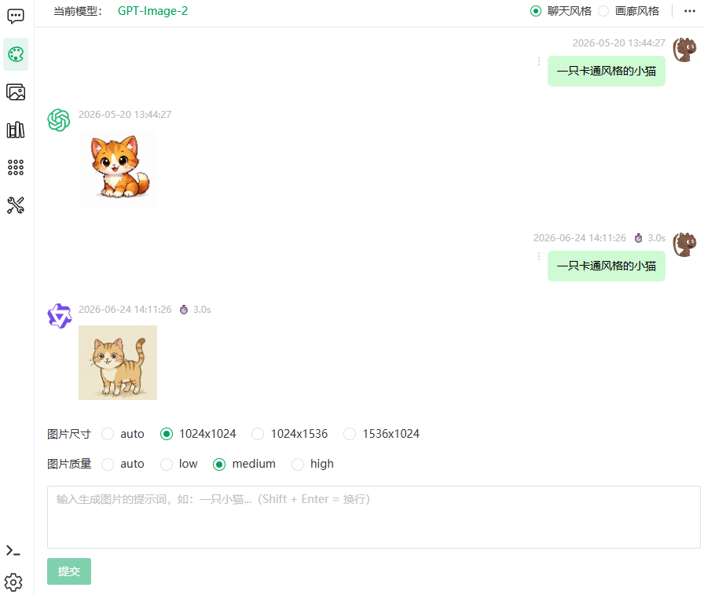
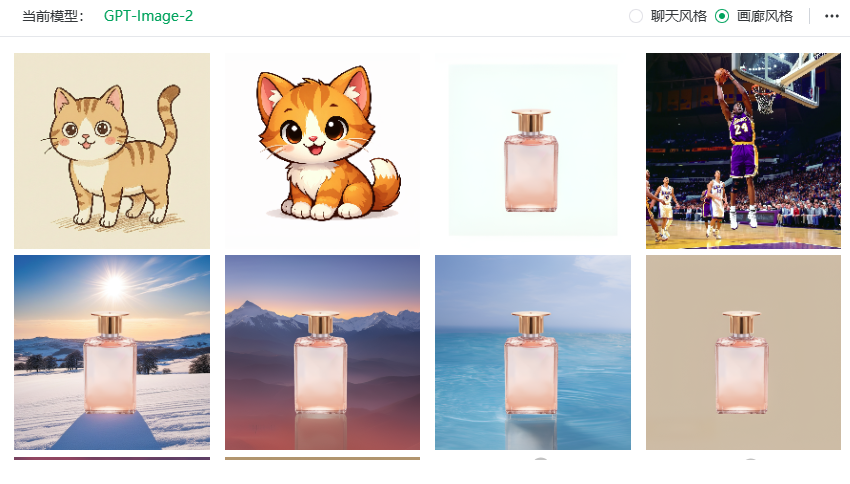
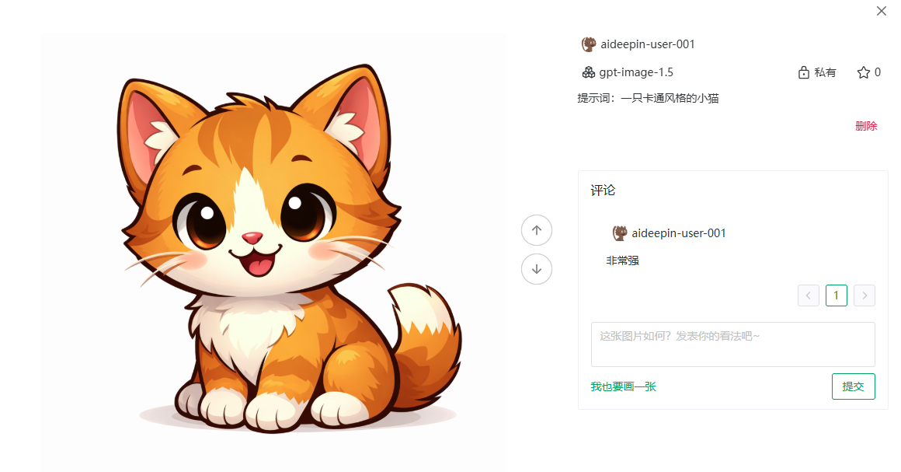

# 绘画

> [← 使用指南](../index.md) · [English](../../../en/guide/draw/draw.md)

进入**绘画**页面后，顶部可选择图片模型，中部为提示词编辑器（按所选模型平台切换形态），下方为**我的绘图记录**。

<figure>
  
  <figcaption>绘画页（聊天风格）</figcaption>
</figure>

<figure>
  
  <figcaption>绘画页（画廊风格）</figcaption>
</figure>

## 生成流程

1. 在顶部的图片模型选择器中挑选模型——所有平台共用同一编辑器，参数区随所选模型的配置变化；
2. 在提示词输入框描述想要的画面（中英文均可）；
3. 按需调整编辑器参数（尺寸、数量、种子等，见下节）；
4. 点击生成，任务异步提交；
5. 完成后图片出现在**我的绘图记录**中，任务执行期间可离开页面，回来后在记录中查看结果。

## 编辑器参数

所有平台共用同一编辑器，参数区随所选模型的配置动态展示；点击参数区右下角的箭头可收起/展开（收起后仅保留提示词输入，为上方图片列表腾出空间）：

| 参数 | 显示条件 | 说明 |
|---|---|---|
| 图片尺寸 | 模型配置了尺寸档位 | 由所选模型的配置决定 |
| 图片数量 | 模型支持多张生成 | 滑杆选择一次生成的张数 |
| 图片质量 | 模型配置了质量档位 | auto / low / medium / high（越高越精细，耗时与成本相应增加） |
| 随机种子 | 模型支持种子 | 指定种子可复现结果；-1 表示随机 |
| 参考图 | 模型声明了图片输入 | 见下文「图生图（参考图）」 |

**图生图（参考图）**：上传参考图后，模型结合参考图与提示词生成新图（图像编辑）；不上传参考图即为文生图。上传上限由模型配置决定（Wan2.7-Image 9 张、Qwen-Image-3.0 3 张、GPT-Image-2 4 张、Kolors 1 张），支持 jpg/png/webp。参考图由服务端直传模型服务，本地文件存储与 OSS 存储均可用，无需图片公网可访问。

### 支持的图片模型（在管理后台「模型管理」中启用）

| 模型 | 平台 | 定位 |
|---|---|---|
| Wan2.7-Image | DashScope | 通用生成+编辑主力：全链路图像编辑（组图、交互式编辑）；文生图最高 4K，编辑场景最高 2K |
| Qwen-Image-3.0 | DashScope | 设计生产力：复杂版面、图中图、高保真文字渲染（10px 小字、12 国语言），适合海报/网页/UI |
| GPT-Image-2 | OpenAI | 文生图与图像编辑；提供质量档位选择 |
| Kolors | SiliconFlow | 免费模型；文生图与图生图（单张参考图） |

## 我的绘图记录

- 列表按时间倒序，**无限上拉加载**，底部提示「没有更多了」。
- 点击记录进入**绘图详情**：
  - 查看提示词与参考图（图生图记录展示所用的参考图；早期「背景生成」记录展示原图/引导图）；
  - 翻看**评论**、点赞；
  - **我也要画一张**：带入该提示词跳转编辑器再创作；
  - **上一个 / 下一个**绘图记录导航，连续翻看。

<figure>
  
  <figcaption>绘图详情</figcaption>
</figure>

### 管理操作

在绘图记录上操作：

| 操作 | 位置 | 说明 |
|---|---|---|
| 删除绘图任务 | 记录更多菜单 | 删除该提示词及其生成的**全部图片**（确认弹窗会列明将删除的内容） |
| 删除单张图片 | 图片上 | 只删该图，保留提示词与其余图片 |
| 公开 / 私有切换 | 记录上 | 公开后图片进入画廊供所有人浏览（提示「可以公开访问」），关闭则恢复私有（「关闭外部访问权限」） |

> [!TIP]
> 想让作品被更多人看到：设为公开后，可在[画廊](gallery.md)的「公开图片」中找到它，并接受评论与点赞。

## API

顶栏**更多 → API** 可生成绘图 API Key 并查看接口文档，把文生图接入你自己的程序（创建任务 + 轮询结果两个接口），详见 [API 参考 · 绘图任务](../../api/draw.md)。

---

上一篇：[语音输入与播报](../chat/voice.md) ｜ 下一篇：[画廊](gallery.md)
