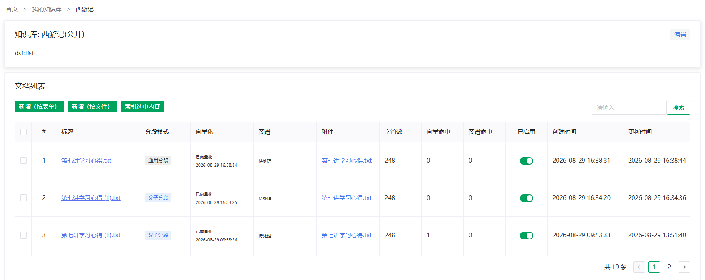
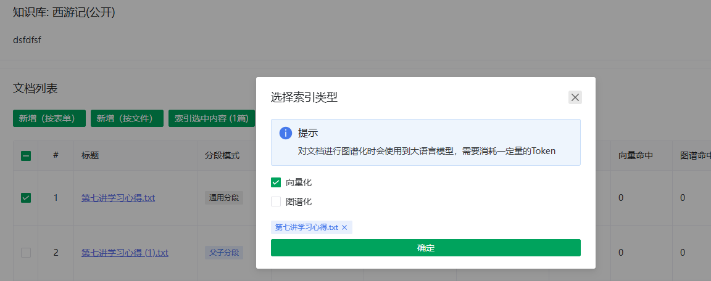

# 导入文档

> [← 使用指南](../index.md) · [English](../../../en/guide/knowledge-base/document.md)

从「我的知识库」点击标题或**文档**操作进入知识库详情页（文档列表），工具条提供两种新增方式：

- **新增（按表单）**：直接录入标题、摘要与正文，适合单篇短内容；
- **新增（按文件）**：批量上传文件，适合正式导入。

<figure>
  
  <figcaption>文档列表</figcaption>
</figure>

## 按文件上传

1. 点击**新增（按文件）**，打开上传弹窗（卡片标题「上传文档以生成文档」）。
2. **选择分段模式**。下拉框下方的灰色说明随模式切换，原文如下：

| 模式 | 界面说明原文 |
|---|---|
| 通用分段 | 通用分段：适用于连续成篇的内容（文章、说明、手册），按知识库分段设置切分，每段直接向量化召回 |
| 问答 | 问答：适用于 FAQ 类内容，以问答对组织；问题被向量化召回，答案原样返回 |
| 父子分段 | 父子分段：适用于长文档，子块精准匹配，命中后返回所属父段作为完整上下文 |

   - **问答**模式仅支持 XLSX / XLS / CSV（可点击**下载模板**），每个文件生成一个独立的问答文档、文件名作为文档标题；文件格式细则见[Q&A 导入与生成](qa-import.md)；
   - **父子**模式显示**子段最大长度**，说明原文：「父段按此大小切分为子段,子段用于精准匹配,命中后返回所属父段作为完整上下文;取值 50-4000,默认 200,修改后重新向量化生效」；
   - **通用分段**沿用知识库的分段设置，无附加参数（文档编辑页会只读显示当前生效的分段配置）。
3. 拖拽文件到上传区（或点击选择）。

| 限制 | 值 |
|---|---|
| 格式 | TXT、PDF、DOC、DOCX、XLS、XLSX、PPT、PPTX |
| 单文件大小 | ≤ 10MB |
| 单次数量 | 最多 20 个 |

4. 点击**上传并生成文档**。上传完成后文档出现在列表中，初始向量化状态为**待处理**。

> [!TIP]
> 扫描版 PDF（图片型）无法提取文本，导入后字符数为 0 或检索不到，请先用 OCR 工具转为文本版再上传。

## 按表单新增

点击**新增（按表单）**进入文档编辑页，填写标题、摘要、正文并选择分段模式，详见[编辑文档](#编辑文档)。问答模式下还可上传 QA 文件或勾选 AI 自动生成，见[Q&A 导入与生成](qa-import.md)。

## 建立索引

上传只是生成了文档与片段，**建立索引后才能被检索到**：

1. 在文档列表勾选一个或多个文档；
2. 点击**索引选中内容（N 篇）**；
3. **选择索引类型**：向量化 / 图谱化（可同时勾选）。弹窗内提示原文：

> [!NOTE]
> 「对文档进行图谱化时会使用到大语言模型，需要消耗一定量的Token」——建议先向量化验证检索效果，再按需图谱化。

4. 点击确定，提示「索引任务后台执行中」，列表每 3 秒自动轮询刷新状态。

<figure>
  
  <figcaption>索引弹窗</figcaption>
</figure>

未图谱化的文档可随时补建：从[分段管理](segment.md)页的文档卡片触发图谱抽取。

## 全量重建

**重建向量**=按现有分段对全部目标重新计算向量，**不改动分段内容与问答对**（问答文档重嵌其问题）——适用于更换嵌入模型、向量状态漂移或批量修复；**重建图谱**=删除旧图谱后重新抽取。与「索引选中内容」的向量/图谱重跑语义相同，区别只是范围：全量重建面向整库或整文档一键执行。两级入口，各分向量与图谱两个维度：

| 入口 | 位置 | 操作 |
|---|---|---|
| **重建向量** / **重建图谱**（库级） | 知识库详情页标题区 | 对**全部文档**执行相应维度（尚无分段的文档按当前分段设置补切后向量化） |
| **重建向量** / **重建图谱**（文档级） | [分段管理](segment.md)页文档卡片 | 仅对该文档执行 |

> [!WARNING]
> 向量重建消耗嵌入额度、图谱重建消耗索引模型额度，文档多时耗时较长（分段内容不受影响）。修改知识库分段参数**不会影响已生成的分段**——参数只作用于后续索引；要让某个文档按新参数重切，编辑该文档（修改正文保存、切换分段模式或子块大小）即可触发改文档重切。

## 文档列表说明

| 列 | 说明 |
|---|---|
| 分段模式 | 通用分段 / 问答 / 父子分段 标签 |
| 向量化状态 | 未开始 / 处理中 / 成功 / 失败；成功/失败可点击查看完成时间/失败原因 |
| 图谱状态 | 未开始 / 处理中 / 成功 / 失败；成功/失败可点击查看完成时间/失败原因 |
| 附件 | 原始上传文件，点击预览 |
| 字符数 | 正文字符量（判断解析是否正常的第一指标） |
| 向量命中 / 图谱命中 | 该文档片段在检索中被命中的次数——长期为 0 说明内容与提问不匹配 |
| 已启用 | 开关。停用后该文档不参与检索（后果见[分段管理](segment.md#片段启停各模式通用)） |
| 创建 / 更新时间 | 最近变更 |

操作列：**详情**（进入文档详情页，含分段管理与图谱入口）、**编辑**、**删除**。

勾选多行后，工具条的**删除（N 篇）**可批量删除选中文档（连同分段、向量与图谱，不可恢复；未勾选时禁用），与**索引选中内容**同为一组选择型批量操作；行内**删除**仍可单条快捷删除。查看或生成图谱请经**详情**进入[分段管理](segment.md)页的文档卡片。

## 编辑文档

列表操作列点击**编辑**（或按表单新增时）可设置：

| 字段 | 说明 |
|---|---|
| 标题 / 摘要 / 正文 | 正文是分段与索引的内容来源 |
| 分段模式 | 模式说明下方常显加粗提示：切换将作废现有片段与向量并按新模式重建；**图谱不自动重建，需手动重新抽取** |
| 分段配置 | 按模式列出实际生效的切分参数：分段 / 父段 / 问答块的最大长度、分段重叠长度、切分策略（自定义时显示分隔符）；父子模式在此编辑**子段最大长度**；问答模式注明问题及答案的长度无需设置；块标题旁括注「（继承自知识库设置）」，其中「知识库设置」四字为链接直达编辑页 |

- 问答模式的附加项（AI 自动生成、导入 QA 对）见[Q&A 导入与生成](qa-import.md)；
- 编辑正文保存后，受影响的片段会自动重新向量化。

> [!WARNING]
> 问答模式下直接编辑正文**不影响**已生成的问答对。要让改动生效，需在问答对列表中手动更新，或用 AI 重新生成（会清空现有问答对）。

---

上一篇：[创建与设置知识库](manage.md) ｜ 下一篇：[Q&A 导入与生成](qa-import.md)
