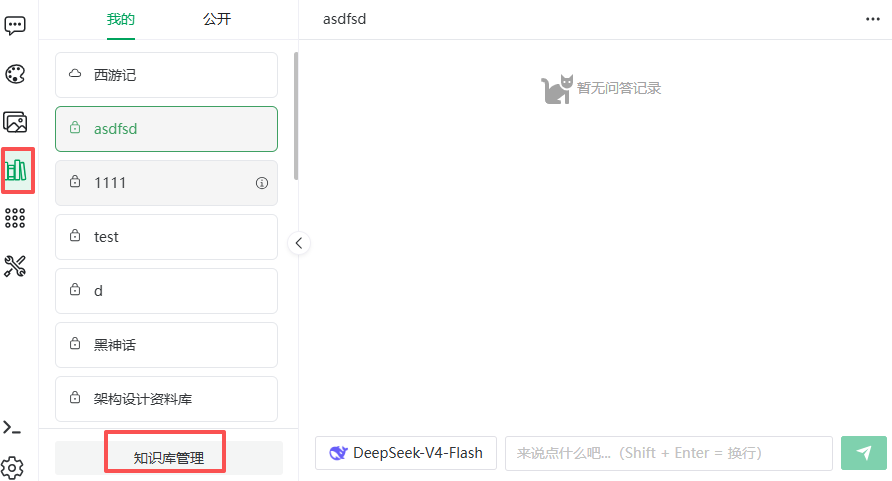

# Knowledge Base Overview

> [← User Guide](../index.md) · [简体中文](../../../cn/guide/knowledge-base/overview.md)

A knowledge base (RAG) gives the AI access to your own material: imported documents are split into **segments** and **indexed**; when you ask, the system retrieves the most relevant segments and injects them into the model, grounding answers with traceable **citations**.

Good use cases: policy Q&A, product-manual support, personal notes search, domain assistants.

## Overall Flow

```
Create knowledge base → Import documents (pick segmentation mode) → Index (vectorize / graph) → Q&A or link to a character
```

| Step | What | See |
|---|---|---|
| 1. Create | Retrieval and segmentation settings | [Create & Configure](manage.md) |
| 2. Import | Form entry or file upload, choose segmentation mode | [Import Documents](document.md) |
| 3. Index | Vectorization (required) and graph extraction (optional) | [Import Documents](document.md#indexing) |
| 4. Maintain | Segment enable/disable, QA maintenance, retries | [Segment Management](segment.md), [Q&A Import & Generation](qa-import.md) |
| 5. Use | Knowledge base Q&A, or link the base to a character | [Knowledge Base Q&A](kb-qa.md), [Character Settings](../chat/character-config.md) |

<figure>
  
  <figcaption>Knowledge base Q&A page</figcaption>
</figure>

<figure>
  
  <figcaption>My knowledge bases page</figcaption>
</figure>

## Two Entry Points

- **Knowledge base Q&A**: the **Knowledge Base** menu item — pick a base and ask;
- **Knowledge base management**: the **Knowledge base management** button at the bottom of the Q&A sidebar (or visit the "My knowledge bases" page directly) — creating and maintaining.

## Three Segmentation Modes

The segmentation mode decides how documents are segmented and retrieved. It is a **document-level property** — chosen when importing or editing a document; one knowledge base can mix modes.

| Mode | Best for | Retrieval |
|---|---|---|
| **Plain segmentation** | Continuous text: manuals, articles | Auto-segmented per the base's segmentation strategy; semantic similarity recall |
| **Q&A** | Paired content: FAQs, support scripts | Question-answer pairs; hitting any question recalls the answer |
| **Parent-child** | Long, hierarchical documents | Small chunks (children) match precisely; the hit returns its **parent** (larger context) to the model |

How to choose:

- Material is naturally question-answer → **Q&A** (highest accuracy, but requires reformatting);
- Continuous prose with clear paragraphs → **plain** (easiest);
- Long documents needing both precise hits and full context → **parent-child** (e.g. a manual: child hits a spec item, parent returns the section).

> [!NOTE]
> Q&A mode only imports XLSX / XLS / CSV files; parent-child mode has its own child chunk max-length setting (default 200).

### Segmentation Settings vs Segment Mode

Segmentation parameters and the segment mode live on two orthogonal levels; the pipeline is "**cut segments first with the base-level segmentation settings, then organize the segments per the document-level mode**":

1. **Segmentation settings (knowledge-base-level)** — the [Document Segmentation Settings](manage.md#2-document-segmentation-settings) configured on the base (segmentation strategy, max segment length, segment overlap length, custom separator, token estimator) decide **where the cut points are**; they apply to every document in the base;
2. **Segment mode (document-level)** — each document chooses **how to organize the segments**:
   - **Plain segmentation**: each segment is vectorized and retrieved directly;
   - **Parent-child**: the segment serves as the **parent**; smaller **child chunks** (at the document's child chunk size) are split inside the parent, only children are vectorized, and a hit returns its parent;
   - **Q&A**: pairs are generated from the body text by AI (questions vectorized, answers returned as-is), with the generation window split at the base-level max segment length. Importing pair files (XLSX/CSV) skips splitting entirely — the only exception.

> [!TIP]
> Naming convention: the top-level split output is always a **segment** (plain segment / parent / answer segment); only parent-child mode splits further into **child chunks** — which is why the child chunk max-length setting exists only on parent-child documents. The "Segmentation config" block on the document edit page lists the effective chunking params per mode (paragraph / parent / QA segment max length, segment overlap length, chunking strategy or custom separator; parent-child adds the child chunk max length) — all sourced from the knowledge base's segmentation settings (an "inherited from knowledge base settings" note beside the block title; the settings words link there).

## Two Index Types

| Index | Purpose | Note |
|---|---|---|
| **Vector index** | Embeds segments for semantic similarity search | The foundation; prerequisite for Q&A |
| **Graph index** | Extracts entities and relations into a knowledge graph | Optional; extraction uses an LLM and **consumes tokens** |

Both can coexist; answers can be traced via citations and the citation graph (see [Knowledge Graph](graph.md)). They complement each other: vectors are best at "semantically similar" content, graphs at "multi-hop relations" (who is the head of A's department).

## Strict vs Lenient Mode

A knowledge-base-level answering strategy (set at creation, see [Create & Configure](manage.md)):

- **Strict**: with no relevant hits, returns "[No answer]" instead of making things up — for policies and compliance;
- **Lenient**: with no hits, the question goes to the LLM for a free-form answer — for assistant scenarios.

## Public vs Private

- **Private**: visible and usable only by the creator;
- **Public**: every user can see and use it (read-only) under the "Public" tab.

## Where to Go Next

| Goal | Page |
|---|---|
| Build a base from scratch | [Create & Configure](manage.md) |
| Import Word / PDF | [Import Documents](document.md) |
| Already have an FAQ sheet | [Q&A Import & Generation](qa-import.md) |
| Keep one segment out of retrieval | [Segment Management](segment.md) |
| Try graph retrieval | [Knowledge Graph](graph.md) |
| Ask the base directly | [Knowledge Base Q&A](kb-qa.md) |

---

Previous: [Gallery](../draw/gallery.md) · Next: [Create & Configure](manage.md)
